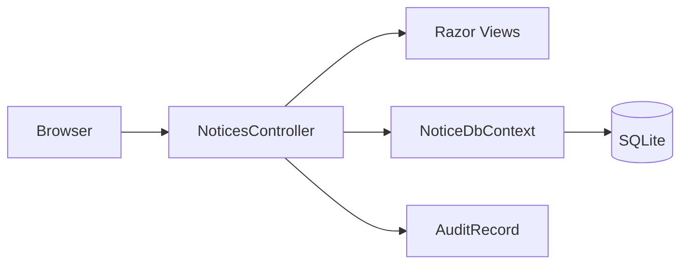

# Architecture

## Scope

The sample is an intentionally small ASP.NET Core MVC application. MVC routes, persistence, and much of the business behaviour are kept close together to make legacy discovery realistic without making the codebase too large for a workshop.

`NoticesController` handles list/search, create, edit, approve, reject, detail, and export. `Notice` holds persisted notice fields and the publication-date calculation. `NoticeDbContext` uses EF Core SQLite and includes synthetic seed data. Tests are split by unit, HTTP integration, and browser journey.

## Boundaries and limitations

- No identity provider, authorisation roles, external integrations, or real maritime data.
- SQLite is suitable only for local repeatable workshop use.
- Schema setup uses `EnsureCreated`; this is not a migration strategy.
- Business validation is not consistently centralised. Treat the observed implementation as evidence, not as authoritative policy.
- In-memory user interface state and browser behaviour are intentionally minimal.
- The facilitator reference is not hidden from a public repository; do not put sensitive data there.

## Data flow

The browser sends MVC form or query requests. The controller reads/writes `NoticeDbContext`; EF Core persists notices and audit rows. Razor encodes normal model values. Export creates a small CSV response. The repository has no production endpoint or credentials.

## Design decision

The controller-led structure is deliberate: it gives participants a visible seam for behaviour discovery and testing. A future narrow refactor should first add characterisation coverage and capture the change in `docs/adr/`.
